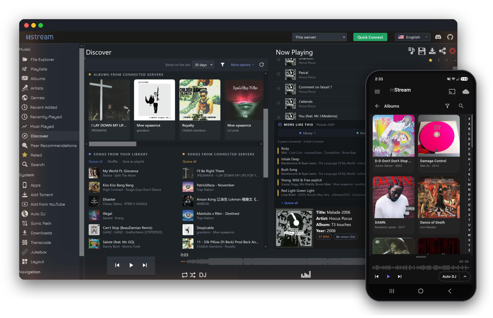

<!-- Translation of README.md as of 2026-11-24. Machine-translated; not yet reviewed by a native speaker. -->
<p align="center"><b>Votre musique vous appartient</b></p>

<p align="center">
  <a href="../../README.md">English</a> ·
  <a href="README.es.md">Español</a> ·
  <a href="README.zh.md">中文</a> ·
  <b>Français</b> ·
  <a href="README.de.md">Deutsch</a> ·
  <a href="README.pt.md">Português</a> ·
  <a href="README.ja.md">日本語</a> ·
  <a href="README.ru.md">Русский</a> ·
  <a href="README.it.md">Italiano</a> ·
  <a href="README.pl.md">Polski</a>
</p>

<p align="center">
  <a href="https://demo.mstream.io/">
    
  </a>
</p>

<p align="center">
  <a href="https://demo.mstream.io/"><b>▶ Essayer la démo en ligne</b></a> ·
  <a href="https://discord.gg/AM896Rr">Rejoignez notre Discord</a> ·
  <a href="https://mstream.io/"><b>Site web</b></a>
</p>


## Installer le serveur mStream

### Docker

[](https://hub.docker.com/r/linuxserver/mstream)

Essayez-le en exécutant la commande suivante.

```shell
docker run -d --name=mstream -p 3000:3000 \
  -v /path/to/config:/config -v /path/to/music:/music \
  lscr.io/linuxserver/mstream:latest
```

[Consultez cette page pour configurer mStream avec Docker Compose](https://github.com/linuxserver/docker-mstream#usage)

### Binaires à télécharger

Les versions binaires offrent quelques fonctionnalités supplémentaires absentes de la version Docker :

* Mises à jour automatiques
* Lecture audio côté serveur
* Une interface graphique pour la configuration

Les binaires peuvent être téléchargés sur [mstream.io/server](https://mstream.io/server).

### Scripts CLI

Ces scripts installent les versions binaires de mStream depuis la ligne de commande

```shell
# Linux / macOS
curl -fsSL https://raw.githubusercontent.com/IrosTheBeggar/mStream/master/install.sh | sh
```

```powershell
# Windows (PowerShell)
irm https://raw.githubusercontent.com/IrosTheBeggar/mStream/master/install.ps1 | iex
```

## Clients mobiles

[](https://play.google.com/store/apps/details?id=mstream.music&pcampaignid=MKT-Other-global-all-co-prtnr-py-PartBadge-Mar2515-1)[](https://apps.apple.com/gb/app/mstream-music/id1455309629)

Ces applications sont [open source](https://github.com/IrosTheBeggar/mstream_music). Nous proposons les [fichiers APK pour une installation manuelle](https://github.com/IrosTheBeggar/mstream_music/releases/latest). Les versions APK offrent quelques fonctionnalités supplémentaires qui ne peuvent pas être publiées dans les versions du Play Store, notamment : la prise en charge des certificats auto-signés, des fonctions de sauvegarde de fichiers et l'intégration de yt-dlp.

Également disponible : [mStream Player par Niera Tech](https://mplayer.nieratech.com/) pour [iOS](https://apps.apple.com/us/app/mstream-player/id1605378892) et [Android](https://play.google.com/store/apps/details?id=com.nieratechinc.mstreamplayer&hl=en_US).

## Client de bureau

| Plateforme | Téléchargement |
|---|---|
| Windows x64 | [mstream-player-desktop-win32-x64.zip](https://github.com/IrosTheBeggar/mstream-terminal-player/releases/latest/download/mstream-player-desktop-win32-x64.zip) |
| macOS Apple Silicon | [mstream-player-desktop-darwin-arm64.app.zip](https://github.com/IrosTheBeggar/mstream-terminal-player/releases/latest/download/mstream-player-desktop-darwin-arm64.app.zip) |
| macOS Intel | [mstream-player-desktop-darwin-x64.app.zip](https://github.com/IrosTheBeggar/mstream-terminal-player/releases/latest/download/mstream-player-desktop-darwin-x64.app.zip) |
| Linux x64 | [mstream-player-desktop-linux-x64.tar.gz](https://github.com/IrosTheBeggar/mstream-terminal-player/releases/latest/download/mstream-player-desktop-linux-x64.tar.gz) |

L'application de bureau est [open source](https://github.com/IrosTheBeggar/mstream-terminal-player)

## Lecteur MP3

Bientôt disponible !


## Fonctionnalités uniques

* **Connexion rapide (Quick Connect) via Iroh** - Connectez votre serveur et vos clients sans configurer de redirection de ports, de certificats SSL, de DNS, etc.
* **Recommandations musicales P2P** - Basées sur le protocole réseau Iroh Gossip. Recevez des recommandations musicales d'autres utilisateurs de mStream.
* **Fédération** - connectez plusieurs serveurs mStream entre eux
* **Auto DJ** - des listes de lecture sans fin qui peuvent puiser de la musique sur n'importe quel serveur d'un réseau fédéré. Il utilise le modèle d'IA local d'apprentissage profond Discogs effNet pour trouver des morceaux au son similaire.


## Autres fonctionnalités

**Écouter**

* Le serveur est léger et fonctionne sur des systèmes peu puissants comme un Raspberry Pi
* Transcodage pour les connexions lentes
* Mode Jukebox : contrôlez à distance la lecture d'un navigateur
* Prise en charge de DLNA
* Recherche automatique des pochettes d'album
* Sauvegardes automatiques sur n'importe quel disque connecté à votre serveur
* Intégration d'un client torrent et téléchargements avec yt-dlp

## Crédits

mStream s'appuie sur d'excellentes bibliothèques open source :

* [music-metadata](https://github.com/Borewit/music-metadata) - L'analyseur de métadonnées utilisé par le scanner JS de secours
* [Lofty](https://github.com/Serial-ATA/lofty-rs) - Lecteur de tags audio sur lequel repose le scanner Rust
* [Symphonia](https://github.com/pdeljanov/Symphonia) - Décodeur audio en pur Rust utilisé pour générer les aperçus de forme d'onde pendant l'analyse
* [Butterchurn](https://github.com/jberg/butterchurn) - Un clone du visualiseur Milkdrop écrit en JavaScript
* [LRCLib](https://lrclib.net/) - Source facultative de paroles synchronisées

Et merci à l'équipe [LinuxServer.io](https://www.linuxserver.io/) qui maintient l'image Docker !
