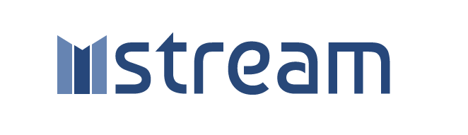

<!-- Translation of README.md as of 2026-11-24. Machine-translated; not yet reviewed by a native speaker. -->
<p align="center">
  
</p>

<p align="center"><b>La tua musica è tua</b></p>

<p align="center">
  <a href="../../README.md">English</a> ·
  <a href="README.es.md">Español</a> ·
  <a href="README.zh.md">中文</a> ·
  <a href="README.fr.md">Français</a> ·
  <a href="README.de.md">Deutsch</a> ·
  <a href="README.pt.md">Português</a> ·
  <a href="README.ja.md">日本語</a> ·
  <a href="README.ru.md">Русский</a> ·
  <b>Italiano</b> ·
  <a href="README.pl.md">Polski</a>
</p>

<p align="center">
  <a href="https://demo.mstream.io/"><b>▶ Prova la demo live</b></a>
  <a href="https://discord.gg/AM896Rr"></a>
  <a href="https://mstream.io/"><b>Sito web</b></a>
</p>

<p align="center">
  <a href="https://demo.mstream.io/">
    
  </a>
</p>


## Installare mStream Server

**Docker**

[](https://hub.docker.com/r/linuxserver/mstream)

Provalo eseguendo il seguente comando.

```shell
docker run -d --name=mstream -p 3000:3000 \
  -v /path/to/config:/config -v /path/to/music:/music \
  lscr.io/linuxserver/mstream:latest
```

[Consulta questa pagina per configurare mStream con Docker Compose](https://github.com/linuxserver/docker-mstream#usage)

**Binari da scaricare**

Programmi di installazione e binari portabili sono [disponibili per macOS, Windows e Linux](https://mstream.io/server). Queste versioni binarie includono alcune funzionalità aggiuntive non disponibili nella versione Docker:

* Aggiornamenti automatici
* Riproduzione audio lato server
* Un'interfaccia grafica per la configurazione

**Script CLI**

Questi script installano le versioni binarie di mStream dalla riga di comando

```shell
# Linux / macOS
curl -fsSL https://raw.githubusercontent.com/IrosTheBeggar/mStream/master/install.sh | sh
```

```powershell
# Windows (PowerShell)
irm https://raw.githubusercontent.com/IrosTheBeggar/mStream/master/install.ps1 | iex
```

## Client mobili

[](https://play.google.com/store/apps/details?id=mstream.music&pcampaignid=MKT-Other-global-all-co-prtnr-py-PartBadge-Mar2515-1)[](https://apps.apple.com/gb/app/mstream-music/id1455309629)

Queste app sono [open source](https://github.com/IrosTheBeggar/mstream_music). Mettiamo a disposizione i [file APK per l'installazione manuale](https://github.com/IrosTheBeggar/mstream_music/releases/latest). Le versioni APK offrono alcune funzionalità aggiuntive che non possono essere pubblicate nelle versioni del Play Store. Tra queste: supporto per i certificati autofirmati, funzioni di backup dei file e integrazione con yt-dlp.

Disponibile anche: [mStream Player di Niera Tech](https://mplayer.nieratech.com/) per [iOS](https://apps.apple.com/us/app/mstream-player/id1605378892) e [Android](https://play.google.com/store/apps/details?id=com.nieratechinc.mstreamplayer&hl=en_US).

## Client desktop

| Piattaforma | Download |
|---|---|
| Windows x64 | [mstream-player-desktop-win32-x64.zip](https://github.com/IrosTheBeggar/mstream-terminal-player/releases/latest/download/mstream-player-desktop-win32-x64.zip) |
| macOS Apple Silicon | [mstream-player-desktop-darwin-arm64.app.zip](https://github.com/IrosTheBeggar/mstream-terminal-player/releases/latest/download/mstream-player-desktop-darwin-arm64.app.zip) |
| macOS Intel | [mstream-player-desktop-darwin-x64.app.zip](https://github.com/IrosTheBeggar/mstream-terminal-player/releases/latest/download/mstream-player-desktop-darwin-x64.app.zip) |
| Linux x64 | [mstream-player-desktop-linux-x64.tar.gz](https://github.com/IrosTheBeggar/mstream-terminal-player/releases/latest/download/mstream-player-desktop-linux-x64.tar.gz) |

L'app desktop è [open source](https://github.com/IrosTheBeggar/mstream-terminal-player)

## Lettore MP3

In arrivo!


## Funzionalità uniche

* **Connessione rapida (Quick Connect) tramite Iroh** - Collega server e client senza configurare port forwarding, certificati SSL, DNS, ecc.
* **Consigli musicali P2P** - Basati sul protocollo di rete Iroh Gossip. Ricevi consigli musicali da altri utenti mStream.
* **Federazione** - collega tra loro più server mStream
* **Auto DJ** - playlist infinite che possono attingere musica da qualsiasi server di una rete federata. Usa il modello locale di IA deep learning Discogs effNet per trovare brani dal suono simile.


## Altre funzionalità

**Ascolta**

* Il server è leggero e funziona anche su sistemi poco potenti come un Raspberry Pi
* Transcodifica per connessioni lente
* Modalità Jukebox: controlla da remoto la riproduzione di un browser
* Supporto DLNA
* Ricerca automatica delle copertine degli album
* Backup automatici su qualsiasi unità collegata al tuo server
* Integrazione con client torrent e download con yt-dlp

## Riconoscimenti

mStream si basa su alcune ottime librerie open source:

* [music-metadata](https://github.com/Borewit/music-metadata) - Il parser di metadati usato dallo scanner JS di riserva
* [Lofty](https://github.com/Serial-ATA/lofty-rs) - Lettore di tag audio alla base dello scanner Rust
* [Symphonia](https://github.com/pdeljanov/Symphonia) - Decoder audio in puro Rust usato per generare le anteprime delle forme d'onda durante la scansione
* [Butterchurn](https://github.com/jberg/butterchurn) - Un clone del visualizzatore Milkdrop scritto in JavaScript
* [LRCLib](https://lrclib.net/) - Fonte opzionale per i testi sincronizzati

E grazie al gruppo [LinuxServer.io](https://www.linuxserver.io/) per la manutenzione dell'immagine Docker!
