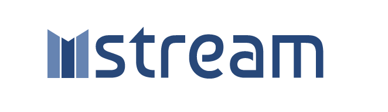

<!-- Translation of README.md as of 2026-11-24. Machine-translated; not yet reviewed by a native speaker. -->
<p align="center">
  
</p>

<p align="center"><b>あなたの音楽を、あなたの手に</b></p>

<p align="center">
  <a href="../../README.md">English</a> ·
  <a href="README.es.md">Español</a> ·
  <a href="README.zh.md">中文</a> ·
  <a href="README.fr.md">Français</a> ·
  <a href="README.de.md">Deutsch</a> ·
  <a href="README.pt.md">Português</a> ·
  <b>日本語</b> ·
  <a href="README.ru.md">Русский</a> ·
  <a href="README.it.md">Italiano</a> ·
  <a href="README.pl.md">Polski</a>
</p>

<p align="center">
  <a href="https://demo.mstream.io/"><b>▶ ライブデモを試す</b></a>
  <a href="https://discord.gg/AM896Rr"></a>
  <a href="https://mstream.io/"><b>ウェブサイト</b></a>
</p>

<p align="center">
  <a href="https://demo.mstream.io/">
    
  </a>
</p>


## mStream サーバーのインストール

**Docker**

[](https://hub.docker.com/r/linuxserver/mstream)

次のコマンドを実行して試せます。

```shell
docker run -d --name=mstream -p 3000:3000 \
  -v /path/to/config:/config -v /path/to/music:/music \
  lscr.io/linuxserver/mstream:latest
```

[Docker Compose で mStream をセットアップする方法はこちらのページをご覧ください](https://github.com/linuxserver/docker-mstream#usage)

**バイナリのダウンロード**

インストーラーとポータブル版のバイナリを [macOS、Windows、Linux 向けに提供しています](https://mstream.io/server)。バイナリ版には、Docker 版にはない追加機能があります。

* 自動アップデート
* サーバー側でのオーディオ再生
* セットアップ用の GUI

**CLI スクリプト**

これらのスクリプトは、コマンドラインから mStream のバイナリ版をインストールします

```shell
# Linux / macOS
curl -fsSL https://raw.githubusercontent.com/IrosTheBeggar/mStream/master/install.sh | sh
```

```powershell
# Windows (PowerShell)
irm https://raw.githubusercontent.com/IrosTheBeggar/mStream/master/install.ps1 | iex
```

## モバイルクライアント

[](https://play.google.com/store/apps/details?id=mstream.music&pcampaignid=MKT-Other-global-all-co-prtnr-py-PartBadge-Mar2515-1)[](https://apps.apple.com/gb/app/mstream-music/id1455309629)

これらのアプリは[オープンソース](https://github.com/IrosTheBeggar/mstream_music)です。[サイドロード用の APK ファイル](https://github.com/IrosTheBeggar/mstream_music/releases/latest)も提供しています。APK 版には、Play ストア版では公開できない追加機能があります。自己署名証明書のサポート、ファイルのバックアップ機能、yt-dlp 連携などです。

[Niera Tech 製の mStream Player](https://mplayer.nieratech.com/) も [iOS](https://apps.apple.com/us/app/mstream-player/id1605378892) と [Android](https://play.google.com/store/apps/details?id=com.nieratechinc.mstreamplayer&hl=en_US) で利用できます。

## デスクトップクライアント

| プラットフォーム | ダウンロード |
|---|---|
| Windows x64 | [mstream-player-desktop-win32-x64.zip](https://github.com/IrosTheBeggar/mstream-terminal-player/releases/latest/download/mstream-player-desktop-win32-x64.zip) |
| macOS Apple Silicon | [mstream-player-desktop-darwin-arm64.app.zip](https://github.com/IrosTheBeggar/mstream-terminal-player/releases/latest/download/mstream-player-desktop-darwin-arm64.app.zip) |
| macOS Intel | [mstream-player-desktop-darwin-x64.app.zip](https://github.com/IrosTheBeggar/mstream-terminal-player/releases/latest/download/mstream-player-desktop-darwin-x64.app.zip) |
| Linux x64 | [mstream-player-desktop-linux-x64.tar.gz](https://github.com/IrosTheBeggar/mstream-terminal-player/releases/latest/download/mstream-player-desktop-linux-x64.tar.gz) |

デスクトップアプリは[オープンソース](https://github.com/IrosTheBeggar/mstream-terminal-player)です

## MP3 プレーヤー

近日公開！


## 独自の機能

* **Iroh によるクイック接続 (Quick Connect)** - ポートフォワーディング、SSL 証明書、DNS などを設定せずに、サーバーとクライアントを接続できます。
* **P2P の音楽おすすめ** - Iroh Gossip ネットワークプロトコルを基盤としています。ほかの mStream ユーザーからおすすめの音楽が届きます。
* **フェデレーション** - 複数の mStream サーバーを相互に接続できます
* **Auto DJ** - フェデレーションネットワーク内のどのサーバーからでも音楽を取り込める、終わりのないプレイリストです。ローカルで動作するディープラーニング AI モデル Discogs effNet を使って、似たサウンドの曲を見つけます。


## その他の機能

**聴く**

* サーバーは軽量で、Raspberry Pi のような低スペックのシステムでも動作します
* 低速回線向けのトランスコード
* ジュークボックスモード: ブラウザーの再生をリモートで操作できます
* DLNA 対応
* アルバムアートの自動取得
* サーバーに接続された任意のドライブへの自動バックアップ
* トレントクライアント連携と yt-dlp によるダウンロード

## クレジット

mStream は、優れたオープンソースライブラリの上に成り立っています。

* [music-metadata](https://github.com/Borewit/music-metadata) - フォールバック用の JS スキャナーが使用するメタデータパーサー
* [Lofty](https://github.com/Serial-ATA/lofty-rs) - Rust スキャナーを支えるオーディオタグリーダー
* [Symphonia](https://github.com/pdeljanov/Symphonia) - スキャン中に波形プレビューを生成するために使用する、純粋な Rust 製のオーディオデコーダー
* [Butterchurn](https://github.com/jberg/butterchurn) - JavaScript で書かれた Milkdrop ビジュアライザーのクローン
* [LRCLib](https://lrclib.net/) - 同期歌詞のオプションの取得元

また、Docker イメージをメンテナンスしている [LinuxServer.io](https://www.linuxserver.io/) の皆さんに感謝します！
